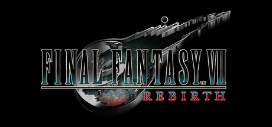

**Final Fantasy VII Rebirth by Square Enix (2024) is the second part of the FF7 remake trilogy.**

---

## 📖 About

Final Fantasy VII Rebirth by Square Enix (2024) is the second part of the FF7 remake trilogy. It follows Cloud and friends journeying from Midgar to the wider world. Its combat mixes real-time action with ATB strategy and features one of the most ambitious mini-game collections in JRPG history.

## ⚠️ Problems Without Trainer

| Problem | Status |
|---------|--------|
| Hard mode locks out items and potions forcing complete materia-based builds | ✅ Solved |
| Queen's Blood card game requires extensive grinding for rare card acquisition | ✅ Solved |
| Synergy abilities require precise stagger timing in fast-moving boss fights | ✅ Solved |
| Materia combination for optimal builds demands 50+ hours of exploration | ✅ Solved |
| Side quest completion needed for chapter select locks behind linear progression | ✅ Solved |

## ✅ Solution

The **Final Fantasy VII Rebirth Trainer** solves all these issues, giving you complete control so you can focus on enjoying the game.

## 🎯 Features

- Unlimited Resources / Currency
- God Mode / Invincibility
- Instant Skill & Ability Cooldown
- One-Hit Kill
- Freeze Timers
- Unlock All Items & Achievements
- Custom Speed Multiplier
- Infinite Stamina / Energy

## 🚀 Quick Start

1. **Disable Windows Defender** temporarily (trainer may trigger false positive)
2. Get the trainer from the button above
3. Launch Final Fantasy VII Rebirth
4. Run the trainer as Administrator
5. Use the hotkeys to activate cheats in-game

## 💎 Free vs Pro

| Feature | Free | Pro |
|---------|------|-----|
| God Mode | ✅ | ✅ |
| Unlimited Resources | ✅ | ✅ |
| Advanced Cheats | ❌ | ✅ |
| Auto-Updates | ❌ | ✅ |
| Priority Support | ❌ | ✅ |

## 💻 Requirements

- Windows 10 / 11 (64-bit)
- Final Fantasy VII Rebirth (any version)
- .NET Framework 4.8+
- DirectX 11+

## 🍎 macOS

## ⚖️ Legal

Educational and single-player use only.

---

